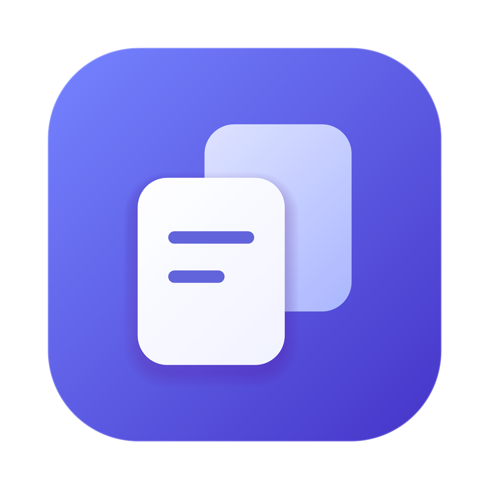

# Copied



Windows 和 macOS 上的剪贴板历史工具，功能参考 [Paste](https://pasteapp.io)。它在后台记录你复制过的内容，按下全局快捷键后在屏幕中央弹出面板，左侧是历史列表，右侧是选中内容的完整预览，可以搜索、筛选，并把选中的内容粘贴回当前应用。

基于 [MyGo](https://github.com/egoist/mygo) 的原生 UI 开发：纯 Go，界面由框架在 GPU 上绘制，不使用 WebView。目前只有本地功能，没有网络同步。

## macOS 安装

当前 macOS 构建**没有 Apple Developer ID 开发者签名，也未经过 Apple 公证**，首次打开需要在系统设置中手动允许。

1. 在本仓库的 [Actions](https://github.com/oneCatZz/Copied/actions/workflows/build.yml) 中，打开一次 **macOS Universal** 打包成功的运行，下载 `Copied-macos-universal` 构建产物并解压，找到 `.dmg` 文件。此版本同时支持 Apple Silicon 和 Intel Mac。
2. 打开 DMG，将 `Copied.app` 拖入“应用程序”（Applications），再从“应用程序”中双击打开 Copied。
3. 如果 macOS 提示无法验证开发者或无法检查 App 是否包含恶意软件，在确认下载自本仓库后，打开“系统设置 → 隐私与安全性”，向下滚动到“安全性”，找到 Copied 的拦截提示，点按“仍要打开”（Open Anyway），按系统提示验证并确认“打开”。如果没有显示此按钮，先再次尝试打开 Copied，再返回该设置页面。
4. 如需自动粘贴，在“系统设置 → 隐私与安全性 → 辅助功能”中允许 Copied；未授权时仍可复制历史记录，再手动按 `⌘V` 粘贴。

手动允许后，后续通常可以直接双击打开。首次打开的系统放行与“辅助功能”授权是两个独立步骤。更多说明见 [Apple 官方指引](https://support.apple.com/zh-cn/102445)。

macOS 构建使用固定的自签名证书“Copied Code Signing”签名，升级到新版本后“辅助功能”授权仍然有效，无需重新添加。从使用此证书之前的旧版本升级时，需要在“辅助功能”列表中删除 Copied 后重新添加一次；如果开关显示已开启但无法自动粘贴，也按此处理。

维护者：证书以 `.p12` 的 base64 存放在仓库 Secrets `MACOS_CERTIFICATE_P12`、`MACOS_CERTIFICATE_PASSWORD` 中，CI 打包时由 `scripts/import-signing-certificate.sh` 导入临时钥匙串；没有这两个 Secret 时（如来自 fork 的 PR）回退为 ad-hoc 签名。本地打包使用同一证书：`go tool mygo build -platform darwin/universal -sign "Copied Code Signing"`。

## 功能

- **记录**：文本、代码片段、链接、颜色值（如 `#3B82F6`）、图片、文件。
- **代码识别**：根据语法特征自动识别常见语言和 Markdown 代码块，预览以等宽字体保留缩进，按浅色 / 深色主题显示语法高亮。识别采用本地规则，模糊片段仍归入文本；复制和粘贴保留原始内容。已有文本历史在首次启动新版时自动分类。
- **预览**：右侧显示选中内容的全文，长文本可滚动；代码可切换“自动换行”；JSON 自动格式化为两空格缩进（含注释的保持原样）；图片显示原图，按空格或单击图片可放大查看（见下文“查看大图”）。超长内容只读取并显示前一部分，粘贴时仍为完整内容。
- **来源应用**：记录每条内容是从哪个应用复制的，显示在列表和预览标题中。Windows 取剪贴板所有者（取不到时为前台窗口）的程序描述名，如 “Google Chrome”；macOS 取当时的前台应用。应用选择列表和搜索框内的应用标签优先使用系统真实图标，并缓存在本地；旧历史会尝试匹配已安装的应用，无法确定图标时显示名称首字，再次从该应用复制后会记录准确路径。在此功能之前记录的条目没有来源。
- **去重**：相同内容不会重复记录，再次复制时移到最前。
- **搜索与筛选**：第一行显示自定义分组，第二行提供加宽的搜索框和内容类型下拉菜单（全部 / 文本 / 代码 / 链接 / 颜色 / 图片 / 文件）。点击搜索框内的应用标签、在搜索开头输入 `@`，或按 `Ctrl/⌘+Shift+A`，可输入应用名称选择来源，支持中文输入法；选中后标签留在搜索框内，继续输入内容关键词，点击标签旁的 × 或在空搜索框按 Backspace 可清除应用筛选。关键词同时匹配正文和来源应用名，分组、应用、类型和关键词可以组合筛选，代码可按原文搜索。
- **粘贴**：选中后自动粘贴到呼出面板之前所在的应用，也可以只复制、或粘贴为纯文本。
- **图片粘贴到终端**：Windows 上目标窗口是终端（Windows Terminal、控制台、mintty，或带伪控制台子进程的终端程序）时，`Enter` 把图片保存为临时 PNG 文件，剪贴板同时写入图片和文件路径，Claude Code、Codex 等 CLI 会把粘贴的路径识别为图片。`Shift+Enter` 在任意应用中把图片粘贴为文件路径文本。临时文件位于 `%TEMP%\Copied`，超过 1 天自动清理。
- **批量复制粘贴**：`Ctrl/⌘+点击` 逐张多选，`Shift+点击` 连选一段，`Shift+↑/↓` 用键盘扩展；选中 2 张以上时，`Enter` 批量粘贴、`Ctrl/⌘+Enter` 批量复制、`Ctrl/⌘+S` 全部加入 Stack、`Esc` 取消选择，右键菜单也作用于所选。按选择顺序合并：文本、代码、链接、颜色每条一行；全是文件时合成一个文件列表，混选时文件以路径写入文本；图片无法并入文本，会被跳过。
- **Stack 顺序粘贴**：用 `Ctrl/⌘+S` 或卡片右键菜单把多条记录依次加入 Stack，列表中显示顺序编号；之后在任意应用按 `Ctrl+Alt+V`（macOS 为 `⌘⌥V`）按顺序逐条粘贴，每粘贴一条即从 Stack 移出；可按住 `Ctrl+Alt`（macOS 为 `⌘⌥`）连续按 `V`。该快捷键只在 Stack 非空时注册；Stack 只保存在内存中，可在面板底部清空。
- **自定义分组**：支持新建、重命名和删除；同一条记录可加入多个分组。原有收藏迁移为默认“收藏”分组，可重命名。已分组的条目不会被自动清理或“清空历史”删除，删除分组不会删除其中的记录。
- **隐私**：密码管理器标记为隐藏的内容不记录；托盘菜单可以暂停记录。
- **外观**：浅色 / 深色跟随系统，分组切换保留流动胶囊，分组宽度随名称自适应；放不下的分组收进“更多”，窄窗口切换为分组选择器，尊重系统的减少动态效果设置。
- **语言**：默认跟随系统，支持简体中文和 English；其他系统语言回退到英文，可在设置中手动切换并保存选择。
- **托盘**：显示当前记录状态，提供剪贴板记录和开机启动开关。
- **后台启动**：启用开机启动后，在用户登录时运行，不自动弹出历史面板。

未分组的历史最多保留 1000 条，面板一次最多显示 200 条。

## 快捷键

全局快捷键默认是 `Ctrl+Shift+V`（macOS 为 `⌘⇧V`）。如果被其他程序占用，会依次尝试 `Alt+Shift+V`、`Ctrl+Alt+Shift+V`。可以在面板右上角的设置按钮、`Ctrl/⌘ + ,` 或托盘菜单的“设置”里修改。

面板内的按键：

| 按键 | 作用 |
|---|---|
| `↑` `↓` | 选择条目 |
| `Shift+↑` `Shift+↓` | 多选条目，用于批量复制粘贴 |
| `Tab` / `Shift+Tab` | 循环切换到下一个 / 上一个分组，包含“更多”中的分组；弹窗内仍用于焦点导航 |
| `Enter` | 粘贴；图片粘贴到终端时同时附带临时文件路径 |
| `Shift+Enter` | 粘贴为纯文本；图片粘贴为临时文件路径 |
| `Space` | 选中图片且搜索框为空时，打开大图查看 |
| `Ctrl/⌘+Enter` | 仅复制，不粘贴 |
| `Ctrl/⌘+1` ~ `9` | 粘贴第 1 ~ 9 条 |
| `Ctrl/⌘+P` | 为当前记录选择分组 |
| `Ctrl/⌘+Shift+A`（默认，可在设置中修改） | 输入应用名称选择来源应用，支持输入法；搜索开头输入 `@` 也可打开 |
| `Ctrl/⌘+S` | 将当前记录加入 / 移出 Stack |
| `Ctrl/⌘+Backspace` | 删除 |
| `Esc` | 取消多选；清空搜索；清除应用筛选；均为空时关闭面板 |

Stack 非空时，默认用 `Ctrl+Alt+V`（macOS 为 `⌘⌥V`）在任意应用中粘贴 Stack 的下一条。可在设置中点击“Stack 粘贴快捷键”录制新组合键，立即生效并在重启后保留；旁边的“恢复默认”只重置 Stack 快捷键。面板和 Stack 快捷键必须不同，`Ctrl/⌘+V` 保留给普通粘贴；组合键被其他程序占用时会提示并保留原设置。录制时按 `Esc` 取消。

设置中的“应用选择快捷键”默认为 `Ctrl/⌘+Shift+A`，可点击录制或单独恢复默认，修改后立即生效并在重启后保留。它仅在面板内生效；与面板、Stack 或已有编辑操作冲突时会提示并保留原设置。`@` 入口始终可用。

鼠标：单击选中，双击粘贴，右键打开菜单；`Ctrl/⌘+点击`、`Shift+点击` 多选。

### 查看大图

选中图片后按 `Space`，或单击右侧预览中的图片，弹出覆盖整个面板的深色遮罩，图片先按窗口大小适应显示。打开面板时光标在搜索框中，搜索框为空且选中图片时，输入的第一个空格（含全角空格）用于打开大图，不写入搜索框；已有搜索内容时空格照常输入。

| 操作 | 作用 |
|---|---|
| 鼠标滚轮 | 以指针位置为中心缩放，每格 1.2 倍，范围从适应窗口到 800% |
| 触控板双指捏合；`Ctrl/⌘` + 滚动 | 缩放 |
| 按住拖动；触控板双指滑动 | 移动图片，不会拖出视野 |
| 双击 | 恢复适应窗口 |
| `Space` / `Esc` / 点击图片外空白处 | 关闭 |

遮罩底部显示当前缩放比例。遮罩打开时其他面板快捷键不生效。macOS 上触控板双指滑动为平移、捏合为缩放，与“预览”一致；Magic Mouse 的滑动按触控板处理，缩放需按住 `⌘`。

顶部 `+` 新建分组，`···` 查看全部分组或重命名、删除当前分组。默认“收藏”分组可以重命名，保留为内置分组。卡片右键的“添加到分组”允许多选，修改立即保存；弹窗内也可以创建分组并加入当前记录。

## 托盘菜单

Windows 和 macOS 点击或右键托盘图标打开分组弹层，顶部显示“记录中”或“已暂停”。

| 操作 | 说明 |
|---|---|
| 打开面板 | 呼出剪贴板历史，右侧显示当前全局快捷键 |
| 设置 | 修改呼出面板的组合键和界面语言 |
| 剪贴板记录 | 暂停或恢复记录，已有历史保留 |
| 开机启动 | 设置是否在当前用户登录时后台运行 |
| 清空历史 | 删除未分组的条目，保留所有分组内容 |
| 退出 Copied | 退出程序并停止记录 |

点击外部、按 `Esc` 或再次点击托盘图标关闭弹层；切换开关时弹层保持打开。支持键盘上下方向键导航。

| 平台 | 图标与弹层 |
|---|---|
| Windows | 靛蓝底色的叠页图标，圆角浮层，快捷键使用 `Ctrl+Shift+V` 等文字表示 |
| macOS | 随菜单栏明暗变化的单色叠页图标，系统 Popover 材质与箭头，快捷键使用 `⌘`、`⇧` 等符号 |

弹层宽度按实际内容测量，较长的自定义快捷键可以撑宽弹层。

## 界面语言

在面板右上角或托盘菜单打开“设置”，可选择“跟随系统 / 简体中文 / English”。语言立即生效，重启后保留选择；主面板、搜索编辑菜单、卡片菜单、托盘菜单、错误提示和相对时间使用同一种语言。剪贴板内容保持原样。

默认按系统首选语言列表匹配中英文，无法匹配时回退到英文。文案位于 `locales/en.json` 和 `locales/zh-Hans.json`，由 MyGo 生成对应的 Go 接口；修改目录后运行 `go tool mygo generate`，可通过 `go tool mygo i18n check` 检查翻译。

## 开机启动

在托盘弹层中启用“开机启动”即可。手动打开程序时会显示历史面板；由登录自启打开时只在后台记录，通过托盘图标或全局快捷键呼出面板。

- **Windows**：向当前用户的 `HKCU\Software\Microsoft\Windows\CurrentVersion\Run` 写入当前程序路径和登录启动参数，不需要管理员权限。可在任务管理器的“启动应用”中管理。移动程序后，重新关闭再开启此开关，以更新启动路径。
- **macOS**：需要使用打包后的 `.app`。macOS 13 及以上使用系统登录项，可在“系统设置 → 通用 → 登录项”中管理；macOS 12 使用 LaunchAgent。

关闭“开机启动”会移除对应的自启设置，不影响当前运行的程序。

## 开发与构建

需要 [Go](https://go.dev/dl/) 1.27.3 或更高版本，不需要 cgo 和 C 编译器。MyGo 当前固定为 `v0.9.0`，命令行工具通过 `go tool` 使用。

```sh
git clone https://github.com/oneCatZz/Copied.git
cd Copied
go run ./scripts/prepare-mygo.go
```

```sh
go tool mygo dev      # 开发模式运行，改动代码后自动重新构建
go tool mygo build    # 打包，输出到 build/
```

MyGo 0.9.0 的渲染缓存会残留旧场景中的图片引用。本项目暂时用 `scripts/prepare-mygo.go` 为固定版本应用最小修复：校验上游文件 SHA-256，在 `.mygo-deps/` 生成独立依赖副本，通过本地 `go.work` 使用它，不修改共享模块缓存。首次克隆后必须先运行上面的准备命令；CI 同样执行，并测试补丁。脚本可重复运行，遇到已有的不同 `go.work` 会停止，避免覆盖个人工作区。升级 MyGo 后需重新审查并移除此临时补丁。

第一次运行会下载 SQLite 的动态库。

### GitHub Actions 打包

推送到 `main` 或在仓库的 [Actions](https://github.com/oneCatZz/Copied/actions/workflows/build.yml) 页面手动运行 **Build Copied**，会先测试并检查 MyGo UI 生命周期，再分别打包：

- `Copied-windows-amd64`：Windows x64 程序、资源及安装包。
- `Copied-macos-universal`：同时支持 Apple Silicon 和 Intel 的 macOS DMG。

在对应运行页面的 **Artifacts** 中下载，产物保留 14 天。PR 也执行相同检查与打包。macOS 产物使用上文的固定自签名证书签名，未经 Apple 公证，首次打开仍会提示未识别的开发者。

## 测试

```sh
go test ./...
go tool mygo vet .
```

测试覆盖类型下拉选择、分组与搜索组合筛选、旧收藏迁移、分组持久化与清理保护、分组动画和响应式布局、弹窗收起重开、卡片按需构建、滚轮边界、缩略图任务取消、LRU 淘汰与图片对象回收。

Windows 原生窗口自动化测试需在桌面会话中启用（PowerShell）：

```powershell
$env:COPIED_NATIVE_TEST = "1"
go test -count=1 -v ./...
```

原生测试使用临时数据库，不启动剪贴板监听、不注册全局快捷键或开机启动项。设置 `COPIED_TEST_ARTIFACTS` 为输出目录可保存渲染截图。

Windows CI 另行运行 `TestWindowsPasteNative`：创建临时 Win32 文本框，验证普通粘贴、按住 Stack 组合键和批量选择修饰键时实际收到的文本。此测试会临时改变前台窗口、按键状态和剪贴板内容；本地运行同样需要桌面会话和 `COPIED_NATIVE_TEST=1`。

另设 `COPIED_NATIVE_MEMORY=1` 和 `COPIED_NATIVE_MEMORY_REPORT`（报告文件路径），可运行包含 120 张合成图片的内存压力场景。报告记录缓存数量、Go 堆、进程工作集和私有提交内存；采样前会强制回收，适合对比保留的内存，不代表日常瞬时占用。

另设 `COPIED_NATIVE_SWITCH=1` 可运行 54 次完整筛选切换，采样隐藏前后的内存，并检查隐藏后销毁、重建以及快速重开时取消销毁的行为。`COPIED_NATIVE_SWITCH_ROUNDS` 可调整轮数（1–12，默认 3，每轮 18 次）；`COPIED_NATIVE_POPUP_ONLY=1` 改为只打开和关闭类型面板。可用 `COPIED_NATIVE_HEAP_PROFILES` 指定 Go 堆采样目录。这些报告来自测试程序，不能直接代表正式构建的进程占用。

Windows 正式构建可用 `scripts/measure-private-memory.ps1` 比较私有提交量、私有工作集与总工作集。必须指定独立的测试数据目录，已有数据可先复制到该目录的 `Copied/history.db`，不要使用日常数据目录：

```powershell
./scripts/measure-private-memory.ps1 -Executable ./build/windows-amd64/Copied.exe -DataDirectory "$env:TEMP/copied-memory-data" -ReportPath "$env:TEMP/copied-memory.json" -StartupOnly
```

`-StartupOnly` 只测登录后台启动和首次打开，不注入输入。去掉它会再切换 24 次类型、隐藏、重开并采样，需要桌面允许测试窗口获得前台焦点；运行期间会移动鼠标并发送按键。脚本使用独立数据和单实例锁，结束后只关闭它启动的测试进程。

## 数据位置

| | 目录 |
|---|---|
| Windows | `%AppData%\Copied` |
| macOS | `~/Library/Application Support/Copied` |

- `history.db`：剪贴板历史（SQLite）。
- `settings.json`：全局快捷键和语言选择；语言为空时跟随系统。

删除这个目录即可清除所有数据。

粘贴到终端的图片临时保存在系统临时目录的 `Copied` 子目录（Windows 为 `%TEMP%\Copied`），不在数据目录中，超过 1 天的文件在下次保存时删除。

开机启动设置由操作系统管理，不保存在 `settings.json` 中；删除数据目录不会取消开机启动。

## 平台说明

- **macOS 自动粘贴需要授权**：在“系统设置 → 隐私与安全性 → 辅助功能”里允许 Copied。未授权时内容只会进入剪贴板，需要手动按 `⌘V`。
- **Linux**：没有原生剪贴板变更通知和自动粘贴实现，不在支持范围内。
- **内存**：占用受屏幕尺寸、缩放率、图片内容和 GPU 驱动影响。登录后台启动时，首次呼出才创建面板和渲染资源。缩略图缓存通常最多 24 项，优先保留可见及邻近图片，超宽屏按需扩容；图片显示后释放 CPU 像素副本。预览使用图片自身圆角和矩形文本裁剪，减少切换动画的圆角遮罩缓存。隐藏面板立即清空应用层图片缓存，2 秒内可快速重开，超过后销毁渲染窗口以释放 UI 与 GPU 缓存，下次呼出时重建。后台继续记录剪贴板，因此进程仍会保留基础内存。在 macOS（Apple Silicon）上实测，415 条记录含 40 张图片时：登录后台启动约 16 MB，打开面板约 230 MB，其中约 180 MB 为图形内存（GPU 纹理与渲染缓冲，随屏幕宽度和缩放率变化）。日常使用中隐藏面板、渲染窗口销毁后约 45 MB。

## 代码结构

| 文件 | 内容 |
|---|---|
| `main.go` | 应用入口、面板窗口、托盘、全局快捷键、剪贴板监听 |
| `tray_menu.go` | Windows / macOS 托盘弹层、记录状态与开关 |
| `view.go` | 面板界面：搜索栏、筛选、历史列表、设置对话框 |
| `preview.go` | 右侧预览：长文本截断、代码高亮与换行、JSON 格式化；大图遮罩的缩放与拖动 |
| `filters.go` | 类型筛选控件与流动胶囊动画 |
| `groups.go` / `group_view.go` | 分组的存储与迁移；分组导航、分组菜单与弹窗 |
| `card_menu.go` | 卡片右键菜单 |
| `stack.go` | Stack 顺序粘贴：队列、全局快捷键、串行粘贴 |
| `batch.go` | 多选与批量复制粘贴的合并规则 |
| `code.go` | 代码识别与语法高亮预览 |
| `ui_style.go` | 弹层表面、对话框按钮等共用样式 |
| `theme.go` | 配色、图标、动画参数 |
| `clip.go` | 条目模型，读写系统剪贴板 |
| `store.go` | SQLite 存储 |
| `settings.go` | 设置的读写，快捷键的录制与显示 |
| `language.go` / `locales/` | 语言选择、系统语言匹配与中英文文案 |
| `platform_*.go` | 各平台的剪贴板变更检测、图片写入、终端识别与模拟粘贴 |
| `terminal.go` | 图片粘贴到终端时保存临时文件并写入路径 |
| `source_windows.go` | Windows 上识别剪贴内容的来源应用 |
| `resources/` | 应用图标、Windows 彩色托盘图标及 macOS 模板图标，包含 SVG 源文件 |
| `macos.entitlements.plist` | macOS 签名权限：允许自签名构建加载内置 SQLite 动态库 |
| `scripts/` | MyGo 补丁准备、CI 签名证书导入、Windows 内存测量 |
