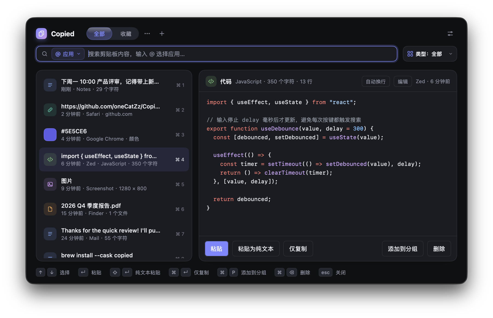
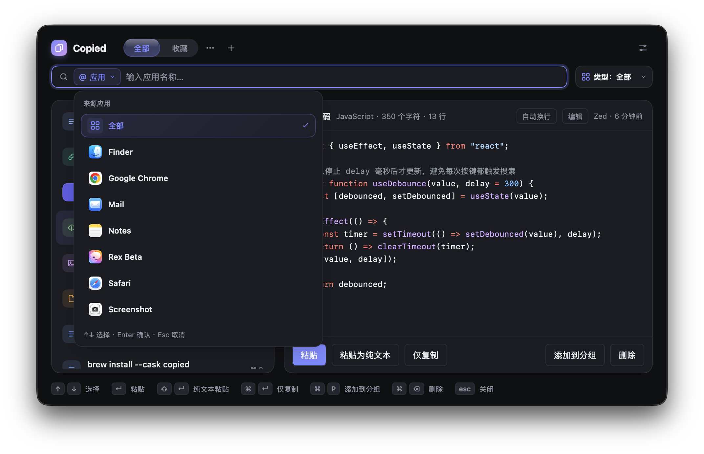
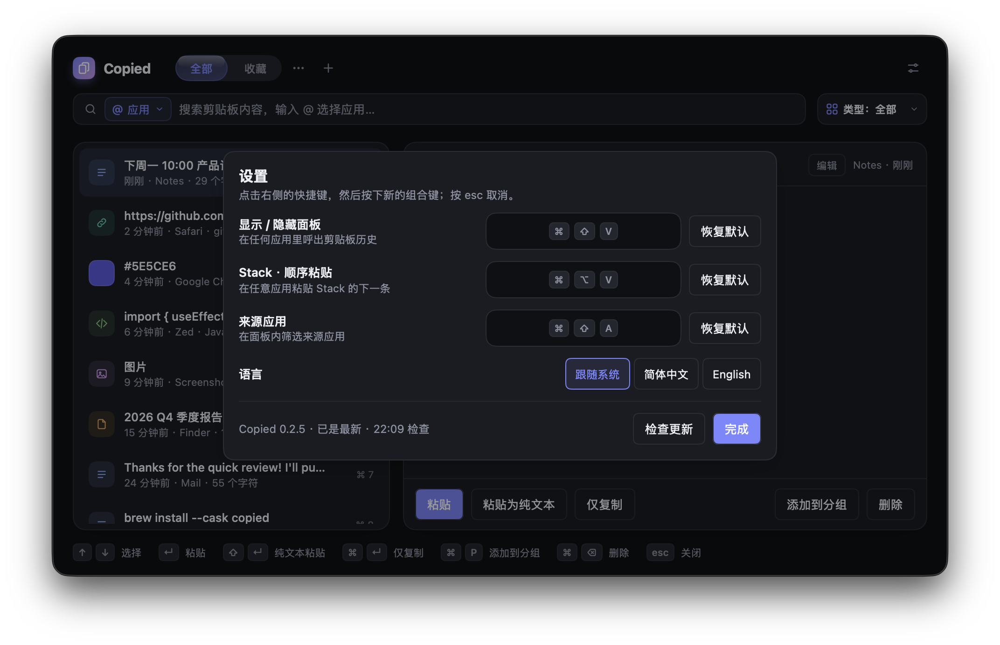
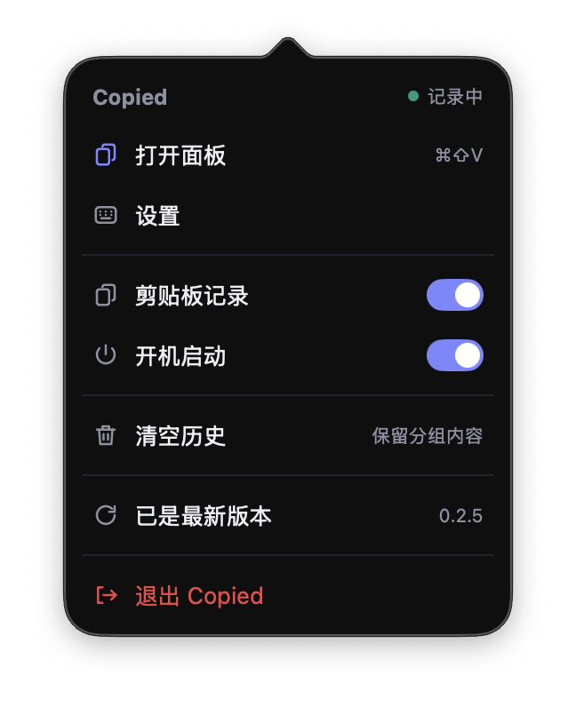

# Copied


Windows 和 macOS 上的剪贴板历史工具。在后台记录复制过的内容，按下全局快捷键即在屏幕中央弹出面板：左侧是历史列表，右侧是完整预览，可以搜索、筛选，并把内容粘贴回当前应用。

纯 Go 编写，基于 [MyGo](https://github.com/egoist/mygo) 的原生 UI，界面由 GPU 绘制，不使用 WebView。数据只保存在本地。



## 安装

### macOS

```sh
curl -fsSL https://github.com/oneCatZz/Copied/releases/latest/download/install.sh | sh
```

脚本安装到“应用程序”（没有写入权限时为 `~/Applications`）并打开，无需在系统设置中手动放行。卸载：`sh install.sh --uninstall`，设置与历史保留。

也可以在 [Releases](https://github.com/oneCatZz/Copied/releases) 下载 DMG（同时支持 Apple Silicon 和 Intel）。应用使用自签名证书，未经 Apple 公证，首次打开需在“系统设置 → 隐私与安全性”中点按“仍要打开”，见 [Apple 官方指引](https://support.apple.com/zh-cn/102445)。

自动粘贴需要在“系统设置 → 隐私与安全性 → 辅助功能”中允许 Copied，未授权时只复制到剪贴板，需手动按 `⌘V`。从早期版本升级后如果无法自动粘贴，在该列表中删除 Copied 再重新添加。

### Windows

在 [Releases](https://github.com/oneCatZz/Copied/releases) 下载安装包。

## 功能

- **多种类型**：文本、代码、链接、颜色、图片、文件；相同内容不重复记录，再次复制时移到最前。
- **代码预览**：自动识别常见语言并高亮，JSON 自动格式化，可切换自动换行。
- **搜索与筛选**：关键词、内容类型、分组和来源应用可组合筛选；在搜索开头输入 `@` 选择来源应用。
- **粘贴**：粘贴到呼出面板前的应用，也可粘贴为纯文本或仅复制；支持多选批量复制粘贴。
- **Stack 顺序粘贴**：把多条记录加入 Stack，在任意应用按 `⌘⌥V`（Windows 为 `Ctrl+Alt+V`）依次粘贴。
- **分组**：自定义分组，一条记录可加入多个分组；分组内的记录不会被自动清理。
- **图片**：大图查看，支持缩放和拖动；Windows 上粘贴到终端时附带临时文件路径，Claude Code、Codex 等 CLI 可识别为图片。
- **打开链接**：在预览中按住 `⌘`（Windows 为 `Ctrl`）单击链接。
- **隐私**：不记录密码管理器标记为隐藏的内容，可随时暂停记录。
- **其他**：浅色 / 深色跟随系统，简体中文 / English，开机后台启动，自动更新。

未分组的历史最多保留 1000 条。



## 快捷键

全局快捷键默认为 `⌘⇧V`（Windows 为 `Ctrl+Shift+V`），可在设置中修改。



面板内（Windows 上 `⌘` 换成 `Ctrl`）：

| 按键 | 作用 |
|---|---|
| `↑` `↓` | 选择，按住 `Shift` 多选 |
| `Enter` | 粘贴 |
| `Shift+Enter` | 粘贴为纯文本 |
| `⌘Enter` | 仅复制 |
| `⌘1` ~ `⌘9` | 粘贴第 1 ~ 9 条 |
| `Space` | 查看大图 |
| `Tab` | 切换分组 |
| `⌘P` | 添加到分组 |
| `⌘⇧A` 或 `@` | 选择来源应用 |
| `⌘S` | 加入 / 移出 Stack |
| `⌘⌫` | 删除 |
| `Esc` | 取消多选、清空搜索，或关闭面板 |

鼠标：单击选中，双击粘贴，右键打开菜单。

## 菜单栏

点击菜单栏图标（Windows 为通知区域图标）打开弹层，可以打开面板、修改设置、暂停记录、开关开机启动、清空历史（保留分组内容）和检查更新。



## 自动更新

启动后定期检查 GitHub Releases，发现新版本时在后台下载并校验签名。弹层顶部出现“重启以完成更新”时可立即重启，不操作也会在空闲时自动完成。更新不经过浏览器，“辅助功能”授权保持有效。

## 数据位置

| 平台 | 目录 |
|---|---|
| macOS | `~/Library/Application Support/Copied` |
| Windows | `%AppData%\Copied` |

`history.db` 为剪贴板历史，`settings.json` 为设置。删除该目录即可清除所有数据。

## 开发

需要 Go 1.27.3 或更高版本，不需要 cgo。

```sh
git clone https://github.com/oneCatZz/Copied.git
cd Copied
go run ./scripts/prepare-mygo.go   # 首次克隆后运行：为 MyGo 0.9.0 应用临时补丁
go tool mygo dev                   # 开发模式，改动后自动重新构建
go tool mygo build                 # 打包到 build/
go test ./...
```

推送到 `main` 或提交 PR 时，GitHub Actions 会测试并打包 Windows 与 macOS 版本。Windows 原生窗口测试与内存测量见 `native_windows_test.go` 和 `scripts/measure-private-memory.ps1`。

### 发布

1. 修改 `mygo.json` 中的 `version`，提交并推送。
2. 推送同名 tag：`git tag v0.2.0 && git push origin v0.2.0`。
3. **Release Copied** 工作流构建、签名并上传到草稿 Release，检查后发布。

所需 Secrets：`MYGO_UPDATER_PRIVATE_KEY`（更新签名私钥，丢失后已安装的应用无法再更新，需另外备份），`MACOS_CERTIFICATE_P12` 与 `MACOS_CERTIFICATE_PASSWORD`（macOS 自签名证书 “Copied Code Signing”，缺少时回退为 ad-hoc 签名）。

## 许可

[MIT](LICENSE)

## 致谢

感谢 [Linux DO](https://linux.do) 社区的支持。
